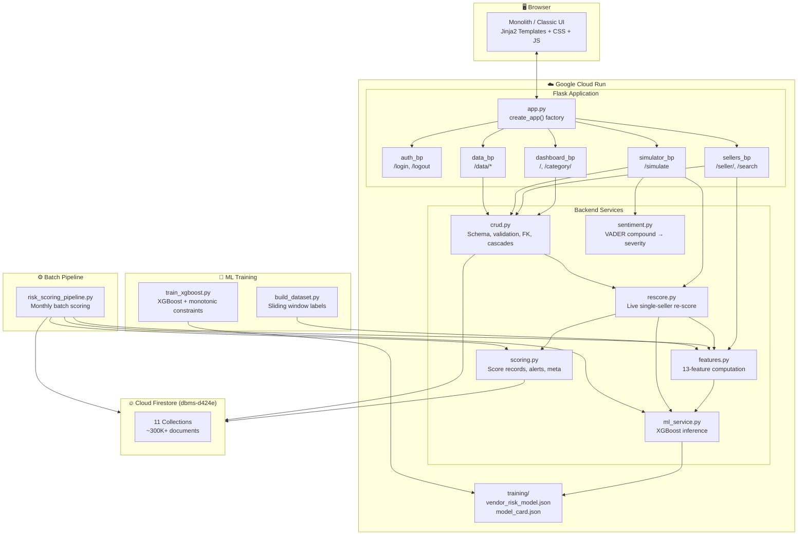
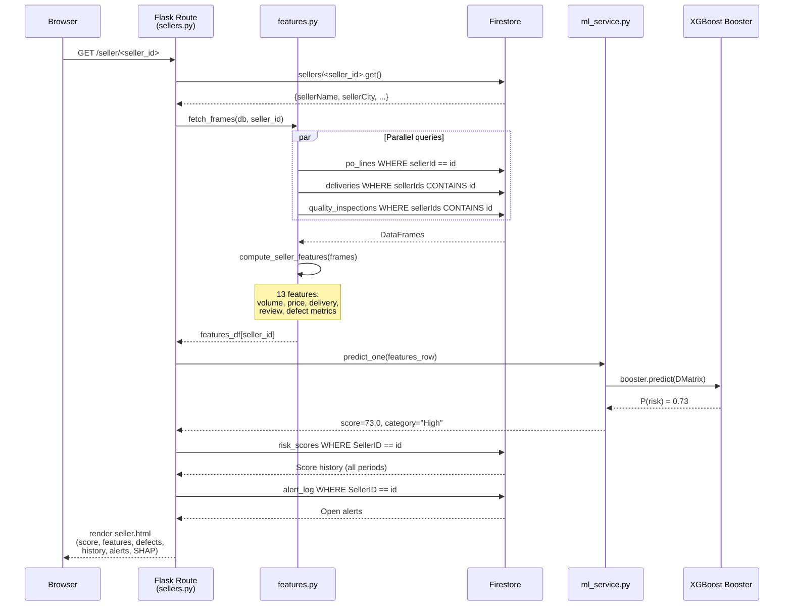
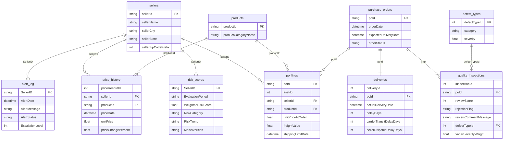
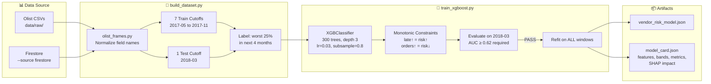
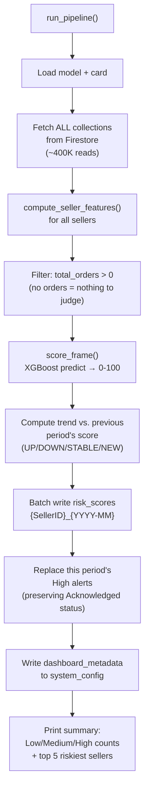
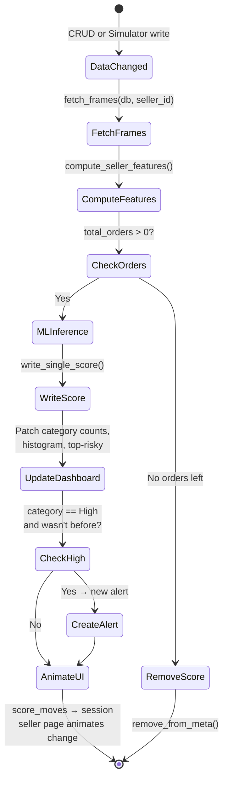
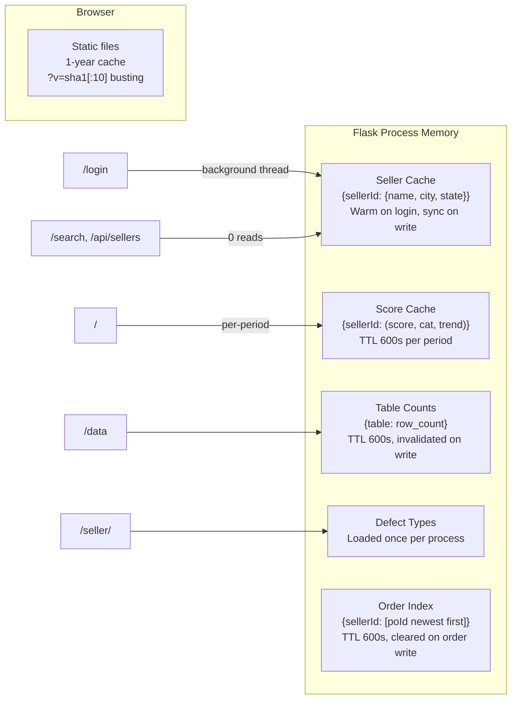
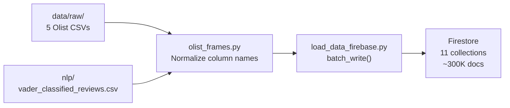
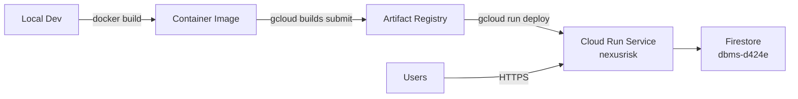

<p align="center">
  
</p>

<h1 align="center">NexusRisk — Supply Chain Vendor Risk Scoring Platform</h1>

<p align="center">
  <strong>ML-powered risk intelligence for vendor portfolio management</strong><br>
  Flask · XGBoost · Firestore · VADER NLP · Cloud Run
</p>

<p align="center">
  
  
  
  
  
  
</p>

---

## Table of Contents

- [Overview](#overview)
- [Key Capabilities](#key-capabilities)
- [System Architecture](#system-architecture)
- [Request Lifecycle](#request-lifecycle)
- [Technology Stack](#technology-stack)
- [Project Structure](#project-structure)
- [Database Schema — Firestore Collections](#database-schema--firestore-collections)
- [Entity-Relationship Diagram](#entity-relationship-diagram)
- [Machine Learning Pipeline](#machine-learning-pipeline)
  - [Training Pipeline](#training-pipeline)
  - [Feature Engineering](#feature-engineering)
  - [Model Architecture & Evaluation](#model-architecture--evaluation)
  - [Batch Scoring Pipeline](#batch-scoring-pipeline)
  - [Live Re-Scoring](#live-re-scoring)
- [NLP — Sentiment & Defect Classification](#nlp--sentiment--defect-classification)
- [Frontend Architecture](#frontend-architecture)
  - [Monolith Theme — Design System](#monolith-theme--design-system)
  - [Classic Theme — Glassmorphism](#classic-theme--glassmorphism)
  - [Page-by-Page Breakdown](#page-by-page-breakdown)
- [CRUD Engine](#crud-engine)
- [Caching Architecture](#caching-architecture)
- [Authentication & Security](#authentication--security)
- [API & Route Reference](#api--route-reference)
- [Testing](#testing)
- [ETL — Data Loading](#etl--data-loading)
- [Deployment](#deployment)
  - [Docker Build](#docker-build)
  - [Google Cloud Run](#google-cloud-run)
- [Local Development Setup](#local-development-setup)
- [Configuration Reference](#configuration-reference)
- [Source Data — Olist Dataset](#source-data--olist-dataset)

---

## Overview

**NexusRisk** is a full-stack web application that scores **3,095+ marketplace sellers** for supply chain risk using an XGBoost gradient-boosted classifier trained on 13 engineered features extracted from order, delivery, review, and pricing data. The system ingests ~100K orders from the [Brazilian E-Commerce (Olist) dataset](https://www.kaggle.com/datasets/olistbr/brazilian-ecommerce), enriches reviews with VADER sentiment analysis and a 7-category NLP defect taxonomy, and produces per-seller risk scores on a 0–100 scale categorized into **Low** (<40), **Medium** (40–60), and **High** (≥60) risk bands.

The Flask web interface provides a real-time dashboard with risk distribution histograms, a per-seller "dossier" page with live ML inference and SHAP-based feature contribution explanations, a risk event **simulator** that lets users inject synthetic orders (with NLP-scored review text and delivery delays) and see scores update instantly, and a full **CRUD interface** across all 11 Firestore collections with foreign key enforcement, cascade deletes, and automatic re-scoring of affected sellers.

The application is deployed on **Google Cloud Run** via Docker, backed by **Cloud Firestore** (project `dbms-d424e`), and includes 13 automated tests that run against an in-memory fake Firestore without any cloud credentials.

---

## Key Capabilities

| Capability | Description |
|:---|:---|
| **XGBoost Risk Scoring** | Binary classifier (P(worst 25% next 4 months) × 100) with monotonic constraints ensuring common-sense risk direction |
| **Live Re-Scoring** | Every data edit (CRUD or simulator) triggers instant per-seller feature recomputation → ML inference → dashboard update |
| **VADER Sentiment** | Review text sentiment analysis using VADER (Valence Aware Dictionary and sEntiment Reasoner), mapped to a 0–5 defect severity scale |
| **7-Category Defect Taxonomy** | NLP-classified review defects: Not a Defect, Service Defect, Quality Issue, Logistics Issue, Fulfillment Error, Major Product Issue, Critical Failure |
| **SHAP Explanations** | XGBoost's exact per-feature contribution (SHAP values) displayed on the seller page: "why did this seller get this score?" |
| **Full CRUD** | Create/Read/Update/Delete for all 11 tables with type validation, FK enforcement, unique key checks, cascade deletes, and derived column auto-computation |
| **Batch Pipeline** | Monthly scoring of all 3,095+ sellers in a single run (~400K Firestore reads), with alert generation and dashboard summary pre-computation |
| **Dual UI Themes** | Switchable via `UI_THEME` env var: production "Monolith" (tactile instrument design) or "Classic" (glassmorphism) |
| **Mechanical Animations** | Odometer digit rolls, needle track risk bars, View Transitions API cross-document morphing |
| **Cache Warming** | Login page triggers background thread to pre-fetch all 3,095 sellers into process memory; search and dropdowns serve from cache (0 Firestore reads) |
| **Gzip + Content Hashing** | Static files served with content-hash URLs (`?v=sha1[:10]`) for 1-year cache; text responses gzipped at level 6 |

---

## System Architecture



---

## Request Lifecycle

This diagram shows exactly what happens when a user navigates to a seller's page:



---

## Technology Stack

| Layer | Technology | Version | Purpose |
|:---|:---|:---|:---|
| **Language** | Python | 3.11 | All backend code |
| **Web Framework** | Flask | 3.0.3 | Application server, routing, Jinja2 templating |
| **CSRF Protection** | Flask-WTF | 1.2.1 | Cross-site request forgery prevention on all forms |
| **ML Framework** | XGBoost | 2.1.4 | Gradient-boosted tree classifier + SHAP contributions |
| **Data Processing** | Pandas | 2.3.3 | Feature engineering, dataframe joins, aggregations |
| **Numerical** | NumPy | 2.3.4 | Array operations, score quantization |
| **Metrics** | scikit-learn | 1.7.2 | AUC-ROC, PR-AUC evaluation at training time |
| **NLP** | vaderSentiment | 3.3.2 | English review sentiment (compound score −1 to +1) |
| **Database** | Cloud Firestore | — | NoSQL document database (Google Cloud, project `dbms-d424e`) |
| **Firebase SDK** | firebase-admin | 6.5.0 | Server-side Firestore access, batch writes, aggregation |
| **Environment** | python-dotenv | 1.0.1 | `.env` file loading for secrets |
| **WSGI Server** | Gunicorn | 22.0.0 | Production server (1 worker, 8 threads) |
| **Container** | Docker | python:3.11-slim | Deployment image |
| **Cloud** | Google Cloud Run | — | Serverless container hosting |
| **Testing** | pytest | 8.3.3 | 13 automated tests with in-memory fake Firestore |
| **Progress** | tqdm | 4.66.4 | ETL loading progress bars |

---

## Project Structure

```
DBMS PROJECT/
│
├── flask_webapp/                        # Flask application package
│   ├── app.py                           # create_app() factory, gzip, asset hashing, theme switch
│   ├── .env                             # SECRET_KEY, ADMIN_PASSWORD, UI_THEME (git-ignored)
│   ├── templates_monolith/              # Production UI — Monolith theme (17 templates)
│   │   ├── base.html                    # Root layout: fonts, nav, search, flash messages
│   │   ├── login.html                   # Password form + background cache warming
│   │   ├── index.html                   # Dashboard: stat columns, histogram, top-risky, alerts
│   │   ├── seller.html                  # Seller dossier: 112px score, needle track, features, defects
│   │   ├── category_list.html           # Filtered list by risk band (High/Medium/Low)
│   │   ├── search_results.html          # Multi-match search results
│   │   ├── simulate.html               # Event injection: seller dropdown, delay, review text
│   │   ├── add_seller.html              # New seller form
│   │   ├── edit_seller.html             # Edit seller form
│   │   ├── model.html                   # Model card: metrics, feature impact, training details
│   │   ├── data_index.html              # Table index: ER diagram, row counts per collection
│   │   ├── data_list.html               # Paginated table view with FK links and quick-set
│   │   ├── data_record.html             # Single record detail with linked rows
│   │   ├── data_form.html               # Create/edit form (generated from schema)
│   │   ├── data_delete.html             # Cascade preview before delete
│   │   ├── _data_macros.html            # Jinja2 macros for data pages (row rendering, pagination)
│   │   └── error.html                   # 404/400/503 error page
│   ├── templates/                       # Classic UI — Glassmorphism theme (15 templates)
│   │   └── ... (same pages, different design)
│   └── static/
│       ├── monolith/
│       │   ├── motion.css               # Odometer keyframes, needle track, view transitions
│       │   ├── motion.js                # Digit roll animation, IntersectionObserver triggers
│       │   └── data.css                 # Data pages styling (tables, forms, ER diagram)
│       └── fonts/                       # Self-hosted WOFF2 fonts
│           ├── InstrumentSerif-Regular.woff2
│           ├── InstrumentSerif-Italic.woff2
│           ├── SpaceGrotesk-Variable.woff2
│           ├── JetBrainsMono-Regular.woff2
│           ├── JetBrainsMono-Medium.woff2
│           ├── JetBrainsMono-SemiBold.woff2
│           └── JetBrainsMono-Bold.woff2
│
├── backend/                             # Server-side business logic
│   ├── __init__.py
│   ├── firebase_client.py               # Firebase Admin SDK init → exports `db`
│   ├── crud.py                          # 835-line CRUD engine: schema, validation, FK, cascades
│   ├── features.py                      # 13-feature computation from raw Firestore collections
│   ├── ml_service.py                    # XGBoost model loading, scoring, SHAP explanations
│   ├── scoring.py                       # Score record formatting, dashboard metadata, alerts
│   ├── rescore.py                       # Live single-seller re-score after data changes
│   ├── sentiment.py                     # VADER sentiment → 0–5 defect severity mapping
│   └── routes/
│       ├── __init__.py
│       ├── auth.py                      # /login (HMAC password check), /logout, cache warming
│       ├── dashboard.py                 # / (index), /category/<level>, /api/sellers, seller cache
│       ├── sellers.py                   # /seller/<id>, /search, /seller/new, edit, delete
│       ├── simulator.py                 # /simulate: inject order + review → VADER → re-score
│       └── data.py                      # /data/* CRUD: browse, create, edit, delete all tables
│
├── pipeline/
│   └── risk_scoring_pipeline.py         # Monthly batch: score all sellers, alerts, dashboard meta
│
├── training/
│   ├── build_dataset.py                 # Sliding-window labeling (7 train + 1 test cutoffs)
│   ├── train_xgboost.py                 # XGBoost training with monotonic constraints
│   ├── train_xgboost.ipynb              # Jupyter notebook version (same logic)
│   ├── dataset.csv                      # Generated training table (4,089 rows)
│   ├── vendor_risk_model.json           # Trained XGBoost model (JSON format)
│   ├── model_card.json                  # Model metadata: features, bands, metrics, SHAP impact
│   └── label_classes.json               # Class label mapping
│
├── etl/
│   ├── load_data_firebase.py            # CSV → Firestore uploader (all 11 collections)
│   ├── olist_frames.py                  # CSV → DataFrames with Firestore field names
│   ├── backfill_seller_ids.py           # Backfill sellerIds[] tag on deliveries/reviews
│   ├── import_vader_reviews.py          # Import NLP-classified review data
│   ├── export_seller_features.py        # Export computed features to CSV
│   ├── fix_legacy_categories.py         # Fix old defect category names
│   ├── fix_vader_names.py               # Fix VADER field name inconsistencies
│   └── seller_features.csv              # Exported feature snapshot
│
├── nlp/
│   ├── classify_reviews.py              # VADER + rule-based defect classification script
│   ├── export_reviews.py                # Export reviews for external NLP processing
│   ├── import_classified_reviews.py     # Import classified results back to Firestore
│   ├── vader_classified_reviews.csv     # 99,224 classified reviews (7 categories)
│   ├── classified_reviews.csv           # Intermediate classification output
│   ├── reviews_to_classify.csv          # Reviews queued for classification
│   ├── classification_progress.csv      # NLP processing progress tracker
│   ├── colab_classify_reviews.ipynb     # Google Colab notebook for bulk classification
│   └── colab_vader_precision.ipynb      # Precision evaluation notebook
│
├── data/raw/                            # Source Olist CSV datasets
│   ├── olist_orders_dataset.csv         # ~100K orders
│   ├── olist_order_items_dataset.csv    # ~113K order lines
│   ├── olist_order_reviews_dataset.csv  # ~100K customer reviews
│   ├── olist_sellers_dataset.csv        # 3,095 sellers
│   ├── olist_products_dataset.csv       # ~33K products
│   └── vader_classified_reviews.csv     # NLP-enriched review data
│
├── tests/
│   ├── conftest.py                      # Fixtures: fake Firestore, tiny model, seed data
│   ├── fake_firestore.py                # In-memory Firestore emulator (dict-backed)
│   ├── test_app.py                      # 13 tests: security, features, pipeline, pages, CRUD
│   ├── test_crud.py                     # CRUD-specific tests
│   └── test_monolith.py                 # Monolith theme template tests
│
├── demo/
│   ├── monolith_motion_demo.gif         # Animated demo of odometer + transitions
│   └── monolith_motion_demo.mp4         # Video version
│
├── artifacts/
│   └── nlp_simulation_plan.md           # NLP simulation design notes
│
├── Dockerfile                           # python:3.11-slim → gunicorn on port 8080
├── requirements.txt                     # 12 Python dependencies
├── project_env.py                       # Shared .env loader (PROJECT_ROOT resolution)
├── firebase.json                        # Firebase project configuration
├── firestore.indexes.json               # Composite index definitions
├── firestore.rules                      # Firestore security rules
├── pytest.ini                           # Pytest configuration
├── DESIGN.md                            # Frontend design system specification
└── README.md                            # ← You are here
```

---

## Database Schema — Firestore Collections

NexusRisk uses **11 Firestore collections** totaling ~300K+ documents. Since Firestore is schemaless, all relational rules (types, required fields, foreign keys, cascades, unique constraints) are enforced in [`backend/crud.py`](backend/crud.py).

| # | Collection | Document Key | Description | Est. Docs |
|:--|:---|:---|:---|---:|
| 1 | `sellers` | `sellerId` (given) | Marketplace sellers — each one is scored monthly | 3,095 |
| 2 | `products` | `productId` (given) | Catalogue items sold on order lines | ~33,000 |
| 3 | `purchase_orders` | `poId` (UUID) | Order headers; sellers linked through order lines | ~100,000 |
| 4 | `po_lines` | auto-ID | What was sold, by which seller, at what price | ~113,000 |
| 5 | `deliveries` | auto-ID (serial `deliveryId`) | One per order; days late feeds the risk model | ~97,000 |
| 6 | `quality_inspections` | auto-ID (serial `inspectionId`) | Customer reviews; stars + sentiment + defect type | ~99,000 |
| 7 | `defect_types` | `defectTypeId` (next) | 7-category NLP defect taxonomy (IDs 10–16) | 12 |
| 8 | `price_history` | auto-ID (serial `priceRecordId`) | Past prices per seller and product | ~113,000 |
| 9 | `risk_scores` | `{SellerID}_{YYYY-MM}` | Model output, one per seller per period | ~3,095/period |
| 10 | `alert_log` | auto-ID | Raised when a seller turns High risk | varies |
| 11 | `risk_weight_config` | `weightConfigId` | Default risk weight ratios (delay, quality, price) | 1 |
| — | `system_config` | `dashboard_metadata` | Pre-computed dashboard summary (counts, histogram, top-risky) | 1 |

### Field Schemas

<details>
<summary><strong>sellers</strong></summary>

| Field | Type | Required | Notes |
|:---|:---|:---|:---|
| `sellerId` | string | ✓ | Document ID, 3–64 chars |
| `sellerName` | string | ✓ | Display name |
| `sellerCity` | string | | City |
| `sellerState` | string | | 2-letter state code |
| `sellerZipCodePrefix` | int | | ZIP prefix (0–99999) |

</details>

<details>
<summary><strong>purchase_orders</strong></summary>

| Field | Type | Required | Notes |
|:---|:---|:---|:---|
| `poId` | string | auto | UUID generated on create |
| `orderDate` | datetime | ✓ | When the order was placed |
| `expectedDeliveryDate` | datetime | | Changing it recalculates days late on linked delivery |
| `orderStatus` | choice | ✓ | `created`, `approved`, `invoiced`, `processing`, `shipped`, `delivered`, `canceled`, `unavailable` |

</details>

<details>
<summary><strong>po_lines</strong></summary>

| Field | Type | Required | FK → | Notes |
|:---|:---|:---|:---|:---|
| `poId` | string | ✓ | `purchase_orders` | Order this line belongs to |
| `lineNo` | int | | | Auto-incremented within order |
| `sellerId` | string | ✓ | `sellers` | Who sold this item |
| `productId` | string | | `products` | What was sold |
| `unitPriceAtOrder` | float | | | Price at time of order (R$) |
| `freightValue` | float | | | Shipping cost (R$) |
| `shippingLimitDate` | datetime | | | Latest date seller should ship |

</details>

<details>
<summary><strong>deliveries</strong></summary>

| Field | Type | Required | FK → | Notes |
|:---|:---|:---|:---|:---|
| `deliveryId` | int | auto | | Serial, auto-incremented |
| `poId` | string | ✓ | `purchase_orders` | One delivery per order (enforced) |
| `deliveredCarrierDate` | datetime | | | Handed to carrier |
| `actualDeliveryDate` | datetime | | | Delivered to customer |
| `delayDays` | int | | | Computed: actual − promised; negative = early |
| `carrierTransitDelayDays` | int | auto | | Computed: delivery − carrier handoff |
| `sellerDispatchDelayDays` | int | auto | | Computed: carrier handoff − shipping limit |
| `sellerIds` | array | auto | | Tags for per-seller queries |

</details>

<details>
<summary><strong>quality_inspections</strong> (Reviews)</summary>

| Field | Type | Required | FK → | Notes |
|:---|:---|:---|:---|:---|
| `inspectionId` | int | auto | | Serial |
| `poId` | string | ✓ | `purchase_orders` | Order being reviewed |
| `inspectionDate` | datetime | | | Review timestamp (defaults to now) |
| `reviewScore` | stars (1–5) | ✓ | | Customer rating |
| `rejectionFlag` | string | auto | | `Negative` (≤3★) or `Positive` (4–5★) |
| `reviewCommentTitle` | string | | | Review title |
| `reviewCommentMessage` | text | | | Review body (VADER-scored for sentiment) |
| `defectTypeId` | int | | `defect_types` | NLP-assigned defect category |
| `vaderSeverityWeight` | float | auto | | 0–5 severity from VADER compound |
| `sellerIds` | array | auto | | Tags for per-seller queries |

</details>

<details>
<summary><strong>risk_scores</strong></summary>

| Field | Type | Notes |
|:---|:---|:---|
| `SellerID` | string | FK → sellers |
| `EvaluationPeriod` | string | `YYYY-MM` format |
| `WeightedRiskScore` | float | 0–100 score |
| `RiskCategory` | string | `Low` / `Medium` / `High` |
| `RiskTrend` | string | `UP` / `DOWN` / `STABLE` / `NEW` |
| `ModelVersion` | string | Timestamp of training run |
| `UpdatedAt` | datetime | Last computed |

</details>

<details>
<summary><strong>alert_log</strong></summary>

| Field | Type | Required | Notes |
|:---|:---|:---|:---|
| `SellerID` | string | ✓ | FK → sellers |
| `AlertDate` | datetime | auto | When alert was raised |
| `EvaluationPeriod` | string | auto | Scoring period |
| `ThresholdCrossedCategory` | choice | ✓ | `High`, `Medium`, `Low` |
| `AlertMessage` | text | ✓ | Human-readable alert description |
| `AlertStatus` | choice | ✓ | `Open`, `Acknowledged`, `Resolved` |
| `EscalationLevel` | int (1–3) | ✓ | 1 = new High, 2 = repeat High |
| `Score` | float | | Score at time of alert |

</details>

---

## Entity-Relationship Diagram



---

## Machine Learning Pipeline

### Training Pipeline



### Feature Engineering

All 13 features are computed in [`backend/features.py`](backend/features.py) — a single function `compute_seller_features()` shared by training, batch scoring, and live inference to guarantee consistency:

| # | Feature | Source | Aggregation | Monotonic |
|:--|:---|:---|:---|:---|
| 1 | `total_orders` | po_lines | COUNT DISTINCT poId per seller | −1 (more orders → lower risk) |
| 2 | `total_items` | po_lines | COUNT of lines per seller | −1 |
| 3 | `unique_products` | po_lines | COUNT DISTINCT productId | 0 (unconstrained) |
| 4 | `avg_price` | po_lines | MEAN unitPriceAtOrder | 0 |
| 5 | `avg_freight` | po_lines | MEAN freightValue | 0 |
| 6 | `price_volatility`* | po_lines | STD of unitPriceAtOrder | — |
| 7 | `avg_delay_days` | deliveries | MEAN delayDays | +1 (more delay → higher risk) |
| 8 | `max_delay_days` | deliveries | MAX delayDays | +1 |
| 9 | `pct_late_deliveries` | deliveries | % where delayDays > 0 | +1 |
| 10 | `avg_review_score` | quality_inspections | MEAN reviewScore (1–5) | −1 (worse reviews → higher risk) |
| 11 | `negative_review_rate` | quality_inspections | % where reviewScore ≤ 3 | +1 |
| 12 | `n_reviews` | quality_inspections | COUNT of reviews | −1 |
| 13 | `defect_rate` | quality_inspections | SUM(severity) / total_orders | +1 |

> \* `price_volatility` is computed for the seller page display but **excluded from the model** — it had no consistent link to risk and caused normal orders to move scores.

### Model Architecture & Evaluation

**Question:** "What is the probability that this seller lands in the worst 25% over the next 4 months, where an order is 'bad' if it's late or reviewed ≤ 2 stars?"

**Score:** P(bad) × 100 → bands: **Low** (<40), **Medium** (40–60), **High** (≥60)

**Hyperparameters:**

| Parameter | Value | Rationale |
|:---|:---|:---|
| `n_estimators` | 300 | Enough trees for the learning rate |
| `max_depth` | 3 | Shallow trees prevent overfitting |
| `learning_rate` | 0.03 | Low rate + many trees = stable convergence |
| `subsample` | 0.8 | Row sampling for regularization |
| `colsample_bytree` | 0.8 | Feature sampling per tree |
| `min_child_weight` | 5 | Prevents learning from tiny groups |
| `scale_pos_weight` | 3 | Counteracts 1:3 positive:negative imbalance |
| `monotone_constraints` | per feature | Forces common-sense risk direction |

**Test Metrics (2018-03 cutoff, never seen in training):**

| Metric | Value | Baseline |
|:---|:---|:---|
| AUC-ROC | 0.6594 | 0.50 (random) |
| PR-AUC | 0.3845 | 0.235 (positive rate) |
| vs. `negative_review_rate` alone | — | AUC 0.6204 |
| vs. `pct_late_deliveries` alone | — | AUC 0.5596 |

**Test Band Performance:**

| Band | Sellers | Landed in Worst 25% | Avg Future Bad Rate |
|:---|---:|---:|---:|
| Low | 241 | 12.0% | 15.3% |
| Medium | 304 | 24.3% | 18.4% |
| High | 174 | 37.9% | 23.7% |

> The model's High band captures sellers 3.15× more likely to end up in the worst 25% compared to the Low band.

**Feature Impact (mean absolute SHAP contribution):**

| Rank | Feature | Share |
|:---|:---|---:|
| 1 | avg_delay_days | 16.3% |
| 2 | unique_products | 14.3% |
| 3 | avg_freight | 10.9% |
| 4 | n_reviews | 10.2% |
| 5 | defect_rate | 9.7% |

### Batch Scoring Pipeline

[`pipeline/risk_scoring_pipeline.py`](pipeline/risk_scoring_pipeline.py) runs monthly:



**Output:**
- One `risk_scores` document per seller per period
- `alert_log` entries for all High-risk sellers (escalation 2 if previously High)
- `system_config/dashboard_metadata` with pre-computed counts, histogram, top-risky list

### Live Re-Scoring

Every data edit (CRUD create/update/delete, or simulator event) triggers [`backend/rescore.py`](backend/rescore.py):



The re-score stores the before/after score in the Flask session so the seller page's odometer animation can roll from the old value to the new value on the next page load.

---

## NLP — Sentiment & Defect Classification

### VADER Sentiment Pipeline

Reviews are scored using [VADER](https://github.com/cjhutto/vaderSentiment) (Valence Aware Dictionary and sEntiment Reasoner), a lexicon-based sentiment analyzer optimized for social media text:

```
Review Text → VADER compound (-1 to +1) → severity = max(0, -compound) × 5 → 0–5 scale
```

- **Compound ≤ −0.4** → review_score 1, high severity
- **Compound −0.4 to −0.1** → review_score 2
- **Compound −0.1 to +0.1** → review_score 3 (neutral)
- **Compound +0.1 to +0.5** → review_score 4
- **Compound > +0.5** → review_score 5, zero severity

### 7-Category Defect Taxonomy

| ID | Category | Severity (0–5) | Description |
|:---|:---|---:|:---|
| 10 | Not a Defect | 0.0 | Positive or neutral review, no issue |
| 11 | Service Defect | 2.0 | Customer service complaint |
| 12 | Quality Issue | 2.5 | Minor product quality problem |
| 13 | Logistics Issue | 3.0 | Shipping/delivery complaint |
| 14 | Fulfillment Error | 3.5 | Wrong item, missing item |
| 15 | Major Product Issue | 4.0 | Significant product failure |
| 16 | Critical Failure | 5.0 | Product DOA, safety issue, complete failure |

99,224 reviews were classified using VADER sentiment + rule-based defect categorization in the [`nlp/`](nlp/) pipeline.

---

## Frontend Architecture

### Monolith Theme — Design System

The production UI uses a **"Tactile Instrument"** design language inspired by physical measurement instruments:

**Typography Stack:**
- **Instrument Serif** (Regular + Italic) — headlines and large numbers
- **Space Grotesk** (Variable) — body text and labels
- **JetBrains Mono** (Regular/Medium/SemiBold/Bold) — monospaced data and scores

**Color Palette — Warm Obsidian:**

| Token | Value | Usage |
|:---|:---|:---|
| `--bg` | `#1a1814` | Page background |
| `--surface` | `#252117` | Cards, panels |
| `--surface-raised` | `#2f2a21` | Elevated elements |
| `--border` | `#3d362b` | Borders, dividers |
| `--text` | `#e8e0d4` | Primary text |
| `--text-muted` | `#a89b8a` | Secondary text |
| `--accent` | `#c8a55a` | Interactive highlights |
| `--risk-low` | `#6ecf7a` | Low risk |
| `--risk-med` | `#f5c342` | Medium risk |
| `--risk-high` | `#ef5350` | High risk |

**Motion & Animation:**

| Element | Technique | Details |
|:---|:---|:---|
| **Odometer digits** | CSS `@keyframes roll` | Numbers mechanically roll like a physical counter on page load; each digit column animates independently |
| **Needle track** | CSS `background: linear-gradient` | Risk score visualized as a thin horizontal bar with a positioned needle marker |
| **View Transitions** | `@view-transition { navigation: auto }` | Cross-document morphing: a clicked table row's text smoothly becomes the next page's title |
| **Digit cascade** | `IntersectionObserver` | Numbers only animate when scrolled into view, with staggered delays per column |

**File Map:**
- [`motion.css`](flask_webapp/static/monolith/motion.css) — keyframes, needle track, transitions, odometer
- [`motion.js`](flask_webapp/static/monolith/motion.js) — `rollDigits()`, IntersectionObserver, animation triggers
- [`data.css`](flask_webapp/static/monolith/data.css) — data pages (tables, forms, ER diagram, record detail)

### Classic Theme — Glassmorphism

The alternate "Classic" theme uses a dark **glassmorphism** design:
- **Font:** Geist (variable)
- **Effects:** `backdrop-filter: blur()`, semi-transparent surfaces, neon accent glows
- **Layout:** Centered card-based with gradient borders

Switch themes by setting `UI_THEME=monolith` or `UI_THEME=classic` in `.env`.

### Page-by-Page Breakdown

| Page | Route | Template | Key Elements |
|:---|:---|:---|:---|
| Login | `/login` | `login.html` | Password form, CSRF token, background cache warming thread |
| Dashboard | `/` | `index.html` | 3 stat columns (total/scored/period), risk category cards with counts, score histogram (50-bin), top-risky table (10 rows), recent alerts (5) |
| Seller Dossier | `/seller/<id>` | `seller.html` | 112px risk score with odometer animation, needle track bar, risk category badge, 13-feature telemetry grid, NLP defect breakdown, score history table, open alerts, edit/delete actions |
| Category List | `/category/<level>` | `category_list.html` | All sellers in that risk band, sorted by score descending |
| Search Results | `/search` | `search_results.html` | Multi-match list when search query matches >1 seller |
| Simulator | `/simulate` | `simulate.html` | Seller dropdown (autocomplete), delay days input, review text area, submit → flash result |
| Add Seller | `/seller/new` | `add_seller.html` | ID + name + city + state form |
| Edit Seller | `/seller/<id>/edit` | `edit_seller.html` | Pre-filled form |
| Model Card | `/model` | `model.html` | Training question, metrics, band table, feature impact chart, hyperparameters |
| Data Index | `/data` | `data_index.html` | ER diagram SVG, table cards with row counts (lazy-loaded via `/data/counts`) |
| Data List | `/data/<table>` | `data_list.html` | Paginated rows (50/page), FK links, filters, quick-set buttons |
| Data Record | `/data/<table>/<id>` | `data_record.html` | All fields, linked rows from child tables, edit/delete actions |
| Data Form | `/data/<table>/new` | `data_form.html` | Generated form from schema: types, hints, FK dropdowns, validation errors |
| Delete Preview | `/data/<table>/<id>/delete` | `data_delete.html` | Cascade tree: shows all rows that will be deleted |
| Error | — | `error.html` | 404/400/503 with descriptive messages |

---

## CRUD Engine

[`backend/crud.py`](backend/crud.py) (835 lines) is the single source of truth for all table operations:

### Schema-Driven Design

Every table is defined once as a `Table` dataclass with `Field` descriptors:
- **8 field types:** `str`, `text`, `int`, `float`, `datetime`, `choice`, `stars`
- **Foreign keys:** `ref` field pointing at another table
- **Key strategies:** `given` (user-provided), `uuid` (auto-generated), `next` (max+1), `auto` (Firestore auto-ID), `model` (created by ML)
- **Serial fields:** Auto-incremented integer columns (deliveryId, inspectionId, priceRecordId)

### Enforced Constraints

Since Firestore has no built-in relational rules:

| Rule | Implementation |
|:---|:---|
| **Required fields** | `clean()` returns errors for empty required fields |
| **Type validation** | `_coerce()` parses and validates int/float/datetime/choice |
| **Range checks** | `lo`/`hi` bounds on numeric fields |
| **Foreign keys** | `exists()` check on every FK field at write time |
| **Unique keys** | Document ID collision check for `given` keys |
| **One delivery per order** | Duplicate `poId` check in `deliveries` |
| **Unique line numbers** | Line number collision check within an order |
| **Cascade delete** | `delete_plan()` traverses FK graph, shows preview, then batch-deletes |
| **Restrict delete** | Products/defect types can't be deleted if referenced |

### Derived Columns

Computed automatically on every write:

| Table | Column | Computed From |
|:---|:---|:---|
| deliveries | `delayDays` | `actualDeliveryDate − expectedDeliveryDate` |
| deliveries | `carrierTransitDelayDays` | `actualDeliveryDate − deliveredCarrierDate` |
| deliveries | `sellerDispatchDelayDays` | `deliveredCarrierDate − min(shippingLimitDate)` |
| deliveries | `sellerIds[]` | All sellers on this order's lines |
| quality_inspections | `rejectionFlag` | `Negative` if reviewScore ≤ 3, else `Positive` |
| quality_inspections | `vaderSeverityWeight` | VADER sentiment of review text |
| quality_inspections | `sellerIds[]` | All sellers on this order's lines |
| po_lines | `lineNo` | max existing + 1 within the order |

### Trigger: Automatic Re-Scoring

Any create/update/delete on `po_lines`, `deliveries`, or `quality_inspections` identifies affected sellers and calls `rescore_seller()` for each one.

---

## Caching Architecture



**Key design decisions:**
- **Seller cache** is warmed on the login page (background thread) while the user types their password, so the dashboard loads instantly
- **Score cache** is per-period and invalidated when a new seller is scored
- **Table counts** use Firestore's `COUNT()` aggregation (1 read per 1,000 rows) instead of downloading all docs
- **Search** operates entirely from the in-memory seller cache — 0 Firestore reads per search query

---

## Authentication & Security

| Feature | Implementation |
|:---|:---|
| **Password check** | `hmac.compare_digest()` (constant-time comparison, prevents timing attacks) |
| **CSRF protection** | Flask-WTF `CSRFProtect()` on all POST forms |
| **Session cookies** | `HttpOnly=True`, `SameSite=Lax` |
| **Login guard** | `@login_required` decorator on every route except `/login` and `/logout` |
| **Secrets** | `SECRET_KEY` and `ADMIN_PASSWORD` loaded from `.env` (never committed to git) |
| **Startup check** | `create_app()` raises `RuntimeError` if required env vars are missing |
| **Next-URL validation** | Only same-site paths accepted (blocks open redirect: no `//`, no `\\`) |

---

## API & Route Reference

### Authentication (`auth_bp`)

| Method | Path | Description |
|:---|:---|:---|
| GET | `/login` | Login form (also warms seller cache in background thread) |
| POST | `/login` | Password check → session → redirect to `/` |
| GET | `/logout` | Clear session → redirect to `/login` |

### Dashboard (`dashboard_bp`)

| Method | Path | Description |
|:---|:---|:---|
| GET | `/` | Main dashboard with stats, histogram, top-risky, alerts |
| GET | `/category/<risk_level>` | Filtered seller list for High / Medium / Low |
| GET | `/api/sellers?q=...` | JSON seller search (from memory cache, 0 Firestore reads) |

### Sellers (`sellers_bp`)

| Method | Path | Description |
|:---|:---|:---|
| GET | `/seller/<seller_id>` | Seller dossier: live score, features, defects, history, alerts |
| POST | `/search` | Search by ID or name → redirect if single match, else results page |
| GET | `/seller/new` | New seller form |
| POST | `/seller/new` | Create seller |
| GET | `/seller/<id>/edit` | Edit seller form |
| POST | `/seller/<id>/edit` | Update seller |
| POST | `/seller/<id>/delete` | Delete seller + cascade all linked data |

### Simulator (`simulator_bp`)

| Method | Path | Description |
|:---|:---|:---|
| GET | `/simulate` | Simulation form: seller dropdown, delay, review text |
| POST | `/simulate` | Inject synthetic order → VADER score → live re-score → redirect to seller |

### Data CRUD (`data_bp`, prefix `/data`)

| Method | Path | Description |
|:---|:---|:---|
| GET | `/data/` | Table index with ER diagram and row counts |
| GET | `/data/counts` | JSON row counts per table (aggregation query) |
| GET | `/data/<table>` | Paginated list (50/page), filterable |
| GET | `/data/<table>/new` | Create form (generated from schema) |
| POST | `/data/<table>/new` | Create record (with validation + re-score) |
| GET | `/data/<table>/<doc_id>` | Single record detail + linked rows |
| GET | `/data/<table>/<doc_id>/edit` | Edit form (pre-filled) |
| POST | `/data/<table>/<doc_id>/edit` | Update record |
| GET | `/data/<table>/<doc_id>/delete` | Cascade preview |
| POST | `/data/<table>/<doc_id>/delete` | Execute delete + cascade |
| POST | `/data/<table>/<doc_id>/set` | Quick status change (order status, alert status) |
| POST | `/data/risk_scores/score` | Score one seller now with live model |

---

## Testing

13 automated tests run against an **in-memory fake Firestore** ([`tests/fake_firestore.py`](tests/fake_firestore.py)) — no emulator, no cloud credentials, no network needed.

```bash
python -m pytest tests/test_app.py -q
# 13 passed in ~3s
```

### Test Coverage

| Category | Tests | What's Verified |
|:---|:---|:---|
| **Security** | 4 | Missing secrets → RuntimeError; default password rejected; CSRF blocks token-less forms; all routes redirect to login |
| **Features** | 2 | Batch and single-seller features are identical; known sellers have expected feature values (pct_late=1.0, defect_rate=5.0) |
| **Pipeline** | 1 | Full pipeline: bad seller scores higher than good; empty seller not scored; dashboard metadata correct; alerts generated; re-run doesn't duplicate |
| **Pages** | 3 | Dashboard renders with seller names; category page filters correctly; seller page shows defects and score; 404 for missing sellers |
| **Simulator** | 2 | 30 bad events raise the good seller's score; VADER severity correct; rejects unknown sellers and bad input |
| **CRUD** | 1 | Add/edit/delete seller with cache updates; duplicate ID rejected; search finds edited name |

### Test Fixtures

- **`FakeFirestore`** — dict-backed emulator supporting `collection()`, `document()`, `set()`, `get()`, `stream()`, `where()`, `order_by()`, `limit()`, `batch()`, `get_all()`, `count()`, and tracks read count
- **Tiny XGBoost model** — trained on 600 synthetic rows at test startup; saved to a temp directory
- **Seed data** — 3 sellers: `goodseller01` (20 orders, on-time, 5★), `badseller01` (12 orders, late, 1★, Critical Failure defects), `newseller01` (no orders)

---

## ETL — Data Loading

### Olist CSVs → Firestore

[`etl/load_data_firebase.py`](etl/load_data_firebase.py) transforms raw Olist CSVs into Firestore documents:

```bash
python etl/load_data_firebase.py             # Load all collections
python etl/load_data_firebase.py --replace   # Delete existing, then load
python etl/load_data_firebase.py --collection sellers  # Load one collection
```

**Data flow:**



**Transformations performed:**
- Column renaming (snake_case → camelCase matching Firestore schema)
- Date parsing → Python datetime objects
- Seller name generation: `f"{city}, {state}"`
- Delivery delay computation: `actual − estimated` in days
- VADER defect type ID mapping from category names
- `sellerIds[]` tag computation on deliveries and reviews for efficient per-seller queries
- Price change percent calculation between successive prices

### Additional ETL Scripts

| Script | Purpose |
|:---|:---|
| `backfill_seller_ids.py` | One-time script to add `sellerIds[]` tag to existing deliveries/reviews |
| `import_vader_reviews.py` | Import NLP-classified review data into existing `quality_inspections` |
| `export_seller_features.py` | Export computed features to `seller_features.csv` for analysis |
| `fix_legacy_categories.py` | Migrate old 5-category defect IDs to new 7-category taxonomy |
| `fix_vader_names.py` | Fix `VaderSeverityWeight` → `vaderSeverityWeight` naming inconsistency |

---

## Deployment

### Docker Build

```dockerfile
FROM python:3.11-slim
WORKDIR /app
COPY requirements.txt .
RUN pip install --no-cache-dir -r requirements.txt
COPY . .
ENV FLASK_ENV=production
ENV PYTHONUNBUFFERED=1
EXPOSE 8080
CMD ["gunicorn", "--bind", "0.0.0.0:8080", "--workers", "1",
     "--threads", "8", "--timeout", "120", "flask_webapp.app:app"]
```

> **Why 1 worker?** The in-process seller cache (3,095 sellers) and score cache would be duplicated across workers. One worker with 8 threads handles concurrent requests via GIL-releasing I/O (Firestore network calls, file reads) efficiently.

```bash
docker build -t nexusrisk .
docker run -p 8080:8080 \
  -e SECRET_KEY="your-secret" \
  -e ADMIN_PASSWORD="your-password" \
  -e UI_THEME="monolith" \
  nexusrisk
```

### Google Cloud Run



**Deployment commands:**

```bash
# Build and push to Artifact Registry
gcloud builds submit --tag gcr.io/dbms-d424e/nexusrisk

# Deploy to Cloud Run
gcloud run deploy nexusrisk \
  --image gcr.io/dbms-d424e/nexusrisk \
  --platform managed \
  --region us-central1 \
  --allow-unauthenticated \
  --set-env-vars "SECRET_KEY=...,ADMIN_PASSWORD=...,UI_THEME=monolith"
```

**Cloud Run settings:**
- **Min instances:** 0 (scales to zero when idle)
- **Max instances:** 10
- **Memory:** 512 MiB (XGBoost model + pandas DataFrames + 3,095 sellers in cache)
- **Timeout:** 120s (enough for seller page with parallel Firestore queries)

---

## Local Development Setup

### Prerequisites

- Python 3.11+
- Google Cloud SDK (`gcloud`) or a Firestore service account key
- Git

### Setup

```bash
# Clone
git clone <repo-url>
cd "DBMS PROJECT"

# Create virtual environment
python -m venv .venv
.venv\Scripts\activate        # Windows
# source .venv/bin/activate   # macOS/Linux

# Install dependencies
pip install -r requirements.txt

# Configure environment
cp flask_webapp/.env.example flask_webapp/.env
# Edit .env: set SECRET_KEY, ADMIN_PASSWORD, UI_THEME=monolith
```

### Firestore Authentication (choose one)

```bash
# Option A: Service account key file (recommended for development)
# Place your firebase-key.json in the project root
export GOOGLE_APPLICATION_CREDENTIALS=firebase-key.json

# Option B: Application Default Credentials
gcloud auth application-default login

# Option C: Emulator (offline development)
export FIRESTORE_EMULATOR_HOST=localhost:8080
gcloud emulators firestore start
```

### First-Time Data Load

```bash
# Load raw Olist CSVs into Firestore (only needed once)
python etl/load_data_firebase.py

# Train the ML model (only needed once)
python training/build_dataset.py --source csv
python training/train_xgboost.py

# Run the scoring pipeline (scores all sellers)
python pipeline/risk_scoring_pipeline.py
```

### Run the App

```bash
# Development server (with auto-reload)
cd flask_webapp
set FLASK_DEBUG=1              # Windows
python app.py
# → http://127.0.0.1:5000

# Or with gunicorn (production-like)
gunicorn --bind 127.0.0.1:5000 flask_webapp.app:app
```

### Run Tests

```bash
python -m pytest tests/test_app.py -q
# 13 passed
```

---

## Configuration Reference

### Environment Variables

| Variable | Required | Default | Description |
|:---|:---|:---|:---|
| `SECRET_KEY` | ✓ | — | Flask session encryption key |
| `ADMIN_PASSWORD` | ✓ | — | Login password (compared with `hmac.compare_digest`) |
| `UI_THEME` | | `classic` | `monolith` for production UI, `classic` for glassmorphism |
| `FLASK_DEBUG` | | `false` | Enable debug mode (`1`, `true`, `yes`) |
| `FIREBASE_CREDENTIALS_PATH` | | `firebase-key.json` | Path to service account JSON key |
| `FIRESTORE_EMULATOR_HOST` | | — | If set, connects to Firestore emulator |
| `RISK_MODEL_DIR` | | `training/` | Directory containing model + card JSON files |
| `GOOGLE_APPLICATION_CREDENTIALS` | | — | Standard GCP env var for ADC |

### Risk Band Configuration

| Band | Score Range | Color | Threshold Source |
|:---|:---|:---|:---|
| Low | 0 – 39.99 | `#6ecf7a` green | `model_card.json → bands.Medium` |
| Medium | 40.00 – 59.99 | `#f5c342` amber | `model_card.json → bands.Medium` |
| High | 60.00 – 100 | `#ef5350` red | `model_card.json → bands.High` |

### Internal Constants

| Constant | Value | Location | Purpose |
|:---|:---|:---|:---|
| `PAGE` | 50 | crud.py | Rows per list page |
| `LINKED` | 12 | crud.py | Linked rows shown on record page |
| `BATCH` | 400 | crud.py | Max writes per Firestore batch (limit: 500) |
| `SCORE_TTL` | 600s | dashboard.py | Score cache time-to-live |
| `COUNTS_TTL` | 600s | crud.py | Table count cache TTL |
| `HIST_BINS` | 50 | scoring.py | Dashboard histogram bins |
| `TREND_POINTS` | 5.0 | scoring.py | Score change needed for UP/DOWN trend |
| `TOP_N` | 10 | scoring.py | Top risky sellers on dashboard |
| `MAX_DELAY_DAYS` | 365 | simulator.py | Max allowed simulated delay |
| `MAX_REVIEW_CHARS` | 2000 | simulator.py | Max review text length |

---

## Source Data — Olist Dataset

The [Brazilian E-Commerce Public Dataset by Olist](https://www.kaggle.com/datasets/olistbr/brazilian-ecommerce) provides:

| File | Records | Description |
|:---|---:|:---|
| `olist_sellers_dataset.csv` | 3,095 | Marketplace sellers with city/state/ZIP |
| `olist_orders_dataset.csv` | ~100K | Order headers with dates and status |
| `olist_order_items_dataset.csv` | ~113K | Order lines with seller, product, price, freight |
| `olist_order_reviews_dataset.csv` | ~100K | Customer reviews with 1–5 star rating and text |
| `olist_products_dataset.csv` | ~33K | Product catalogue with categories |

**Time range:** September 2016 – October 2018

**Currencies:** Brazilian Real (R\$)

**NLP enrichment:** 99,224 reviews were classified using VADER sentiment analysis into the 7-category defect taxonomy, producing `vader_classified_reviews.csv` with `DefectCategory` and `SeverityWeight` columns.

---

<p align="center">
  <sub>Built for DBMS Course Submission — 2026</sub>
</p>

